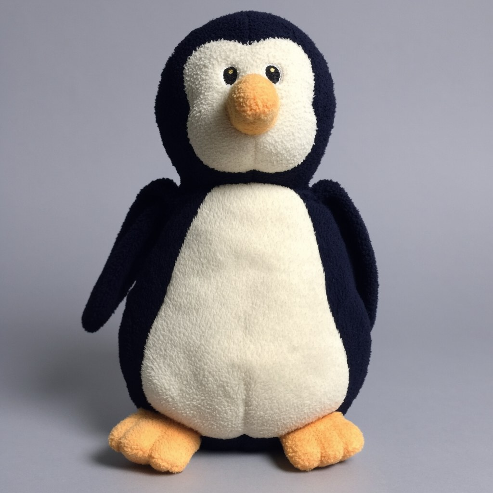
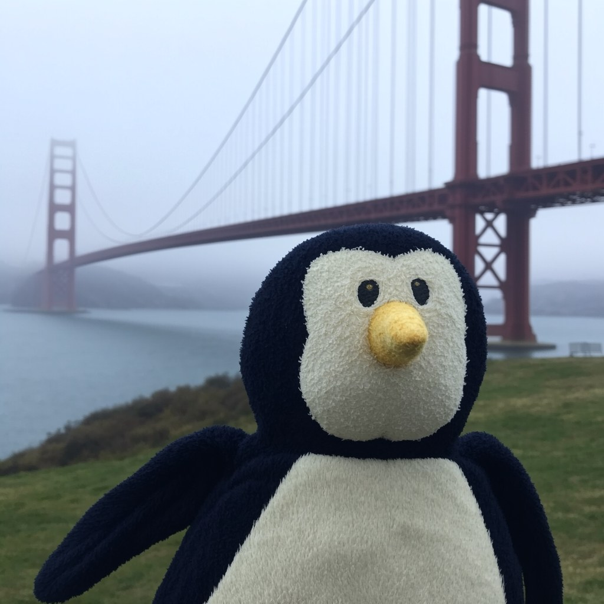
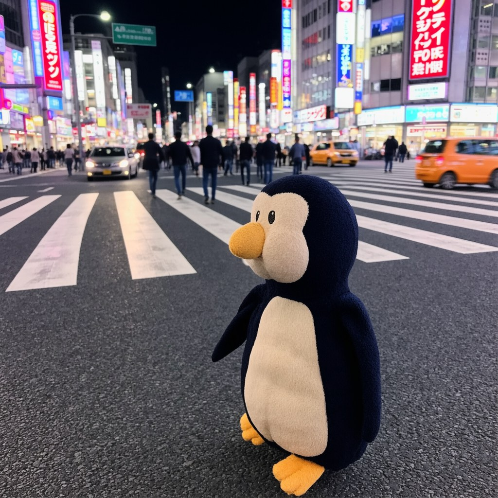
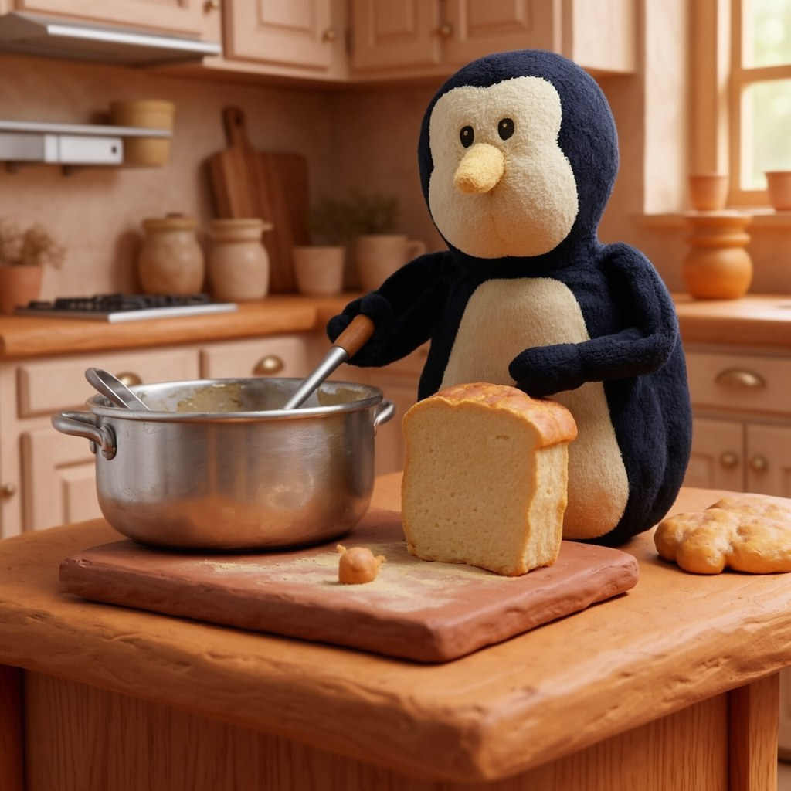
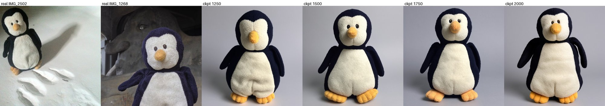
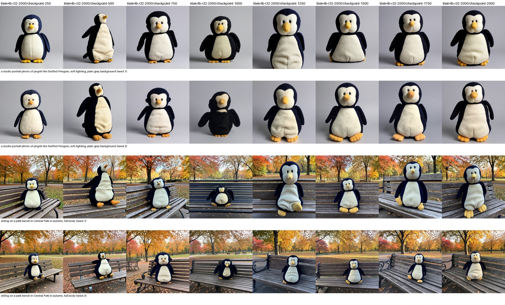

# Penguinoh Generator

Generate new images of [Penguinoh the Stuffed Penguin](https://penguinoh.com), a well-traveled plush who has
been photographed in front of landmarks around the world. This repo trains a LoRA on
[FLUX.2 [klein] base 4B](https://huggingface.co/black-forest-labs/FLUX.2-klein-base-4B) from 52 photos in the
penguinoh.com gallery, and publishes it to
[`eigenben/FLUX.2-klein-base-4B-penguinoh`](https://huggingface.co/eigenben/FLUX.2-klein-base-4B-penguinoh).

| | | |
|:-:|:-:|:-:|
|  |  |  |
|  |  |  |

## Try it on Hugging Face

The [model page](https://huggingface.co/eigenben/FLUX.2-klein-base-4B-penguinoh) has an inference widget, served
by an inference provider and billed to your Hugging Face account. Refer to him as **`pngnh the Stuffed Penguin`**:

- `a photo of pngnh the Stuffed Penguin surfing a big wave in Hawaii`
- `a watercolor painting of pngnh the Stuffed Penguin in Venice`

Or load it with diffusers:

```python
import torch
from diffusers import Flux2KleinPipeline

pipe = Flux2KleinPipeline.from_pretrained("black-forest-labs/FLUX.2-klein-base-4B", torch_dtype=torch.bfloat16).to("cuda")
pipe.load_lora_weights("eigenben/FLUX.2-klein-base-4B-penguinoh", weight_name="pytorch_lora_weights.safetensors")
image = pipe("a photo of pngnh the Stuffed Penguin surfing a big wave in Hawaii",
             num_inference_steps=50, guidance_scale=4.0).images[0]
```

## How it was made

- **Dataset.** 52 of the ~300 gallery photos, picked for variety: full body and close-ups, lying down, side and
  back views, props (a conical hat, a bag of candy), and indoor scenes. Photos with other plush toys, strong
  color casts, or Penguinoh too small to see were left out, as were most near-identical landmark selfies.
- **Captions.** Each photo has its own caption describing the setting, pose and framing — never his appearance —
  so the look is learned by the trigger phrase rather than baked into particular backgrounds.
- **Training.** Diffusers' DreamBooth LoRA script for FLUX.2 [klein] at 1024px with aspect-ratio buckets, rank 32,
  learning rate 1e-4, 2,000 steps on one L40S (about 40 minutes), saving a checkpoint every 250 steps.
- **Picking a checkpoint.** Every checkpoint rendered the same 10 prompts and seeds (`prompts/eval.txt`). Likeness
  is reliable from step 1250; step 1750 had the best likeness while compositions still varied, so it is the
  published default (the repo-root weights on Hugging Face). Every checkpoint is also on the Hub.



<details>
<summary>Checkpoint comparison, steps 250 → 2000</summary>



</details>

## Project layout

```
penguinoh/            Python package and `penguinoh` CLI
  config.py           Trigger phrase, model ids, training defaults, sampler settings
  dataset.py          `penguinoh prepare`: build data/train from website photos
  train.py            `penguinoh train` / `upload`: run the DreamBooth script, publish LoRA weights
  generate.py         `penguinoh generate`: render prompts with one or more LoRAs, plus comparison grids
dreambooth/           train_dreambooth_lora_flux2_klein.py, vendored from diffusers v0.41.0
data/train/           Training photos + metadata.jsonl (file_name, caption) — the dataset manifest
prompts/eval.txt      Fixed prompts for comparing checkpoints
docs/                 Hugging Face model card, samples, and the checkpoint comparison
modal_app.py          Train, generate, and publish on Modal GPUs
runs/, output/        Local training runs and generated images (git-ignored)
```

## Setup

Requires Python 3.12+ and [uv](https://docs.astral.sh/uv/).

```bash
uv sync
```

Accounts used: Hugging Face (`HF_TOKEN`, to download models and publish the LoRA), [Modal](https://modal.com)
for GPUs, and optionally Weights & Biases (`WANDB_API_KEY`, plus `WANDB_ENTITY` to log to a team) for training
logs and validation images.

## Dataset

`data/train/metadata.jsonl` lists each training image and its caption. To add or replace photos, edit the
manifest with the website file name (any extension) and a caption starting with
`a photo of pngnh the Stuffed Penguin`, then rebuild from a checkout of the
penguinoh.com website repo at `../penguinoh_website` (or pass `--source`):

```bash
uv run penguinoh prepare            # copies, EXIF-rotates, strips metadata, resizes to 1600px
uv run penguinoh prepare --prune    # also delete images no longer in the manifest
```

## Training on Modal

One-time Modal secrets (add `WANDB_ENTITY=<team>` to the W&B secret to log to a team):

```bash
modal secret create huggingface-secret HF_TOKEN=<token>
modal secret create wandb-secret WANDB_API_KEY=<key>
```

Train on an L40S. `--detach` keeps it running if your laptop sleeps; runs are saved to the
`penguinoh-generator-runs` volume with a checkpoint every 250 steps.

```bash
uv run modal run --detach modal_app.py::train --run-name my-run
uv run modal run --detach modal_app.py::train --run-name my-run --max-train-steps 3000 --rank 16
```

Render `prompts/eval.txt` for every checkpoint of a run; images and a `grid.jpg` land in `output/<timestamp>/`:

```bash
uv run modal run modal_app.py::generate --run my-run --seeds 1,2
```

Publish the run with your chosen checkpoint as the repo-root weights. This uploads every checkpoint's LoRA
weights (no optimizer state), `docs/MODEL_CARD.md` as the model card, and `docs/samples/`:

```bash
uv run modal run modal_app.py::upload --run my-run --root-checkpoint checkpoint-1750
```

## Generating

On Modal (no local GPU needed):

```bash
uv run modal run modal_app.py::generate --prompt "surfing a big wave in Hawaii" --seeds 1,2,3
uv run modal run modal_app.py::generate --lora none,eigenben/FLUX.2-klein-base-4B-penguinoh   # without vs with
uv run modal run modal_app.py::generate --sampler distilled                                  # 4-step klein-4B
```

Locally (CUDA, or Apple Silicon via MPS — slow):

```bash
uv run penguinoh generate --prompt "surfing a big wave in Hawaii" --seeds 1 2 3
uv run penguinoh generate --lora eigenben/FLUX.2-klein-base-4B-penguinoh/checkpoint-1500   # a specific checkpoint
```

A prompt that doesn't mention `pngnh the Stuffed Penguin` is treated as a scene and becomes
`a photo of pngnh the Stuffed Penguin <scene>`. Name him explicitly for other media.

Samplers: `base` (FLUX.2 klein base 4B, 50 steps, guidance 4.0 — the model the LoRA was trained on) and
`distilled` (FLUX.2 klein 4B, 4 steps, guidance 1.0 — much faster, but likeness with this LoRA is untested).

## Training on another GPU host

```bash
uv sync
uv run --env-file .env penguinoh train --run-name my-run    # .env holds HF_TOKEN and WANDB_API_KEY
uv run --env-file .env penguinoh upload runs/my-run --root-checkpoint checkpoint-1750
```

Or with Docker (NVIDIA):

```bash
docker build -t penguinoh-generator .
docker run --rm --gpus all --env-file .env -v "$PWD/runs:/app/runs" penguinoh-generator
```

Every training default in `penguinoh/config.py` can be overridden on the command line; see
`uv run penguinoh train --help`.

## License

- **Code:** [Apache License 2.0](LICENSE). The vendored `dreambooth/` training script is © The HuggingFace Inc.
  team, also Apache 2.0.
- **Photos, captions, generated images, and LoRA weights:** © Ben Hughes,
  [CC BY-NC 4.0](https://creativecommons.org/licenses/by-nc/4.0/) — see [LICENSE-DATA.md](LICENSE-DATA.md).
- **Base model:** FLUX.2 [klein] base 4B by Black Forest Labs, Apache 2.0.

## Credits

- [FLUX.2 [klein]](https://huggingface.co/black-forest-labs/FLUX.2-klein-base-4B) by Black Forest Labs
- [Hugging Face Diffusers](https://github.com/huggingface/diffusers) DreamBooth LoRA training
- [Modal](https://modal.com) for GPUs
